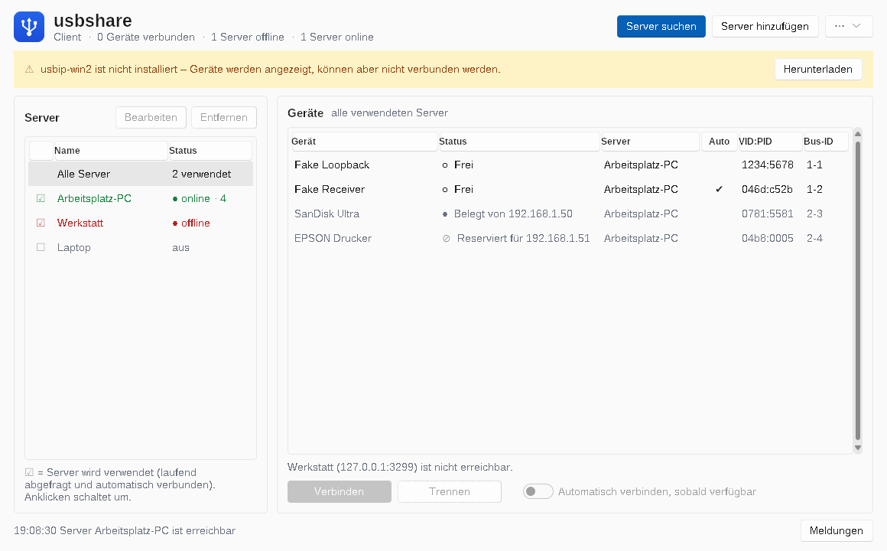
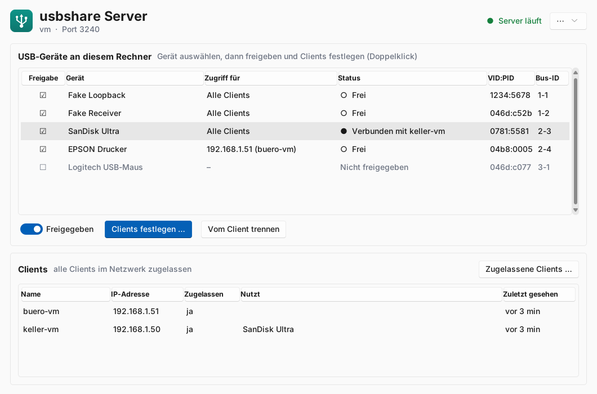
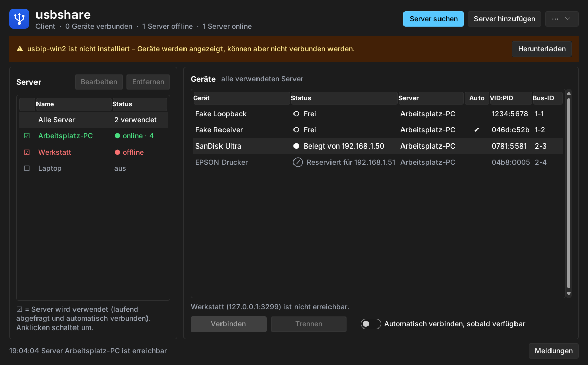

# usbshare

**USB-Geräte über das Netzwerk an eine VM oder einen anderen PC durchreichen** – eine freie
Alternative zu VirtualHere. Der Server läuft auf dem Rechner, an dem die Geräte stecken
(Linux oder Windows; macOS experimentell, nur aus dem Quellcode), der Client auf dem Windows-Rechner bzw. der VM,
die die Geräte nutzen soll.

> **English:** usbshare passes USB devices over the network to a VM or another PC – a free
> alternative to VirtualHere. The programs are available in **English and German**
> (⋯ → Language). This page is in German; see [Translating](TRANSLATING.md) to help with
> other languages.

> [!WARNING]
> **Mit KI erstellt:** Der Code dieses Projekts wurde von **Claude** (KI-Assistent von
> Anthropic) im Auftrag und nach den Vorgaben von Goeste geschrieben. Er wurde getestet,
> aber nicht mit allen Geräten und Konstellationen – er **kann Fehler enthalten**. Nutzung
> auf eigenes Risiko; Fehlerberichte und Verbesserungen sind willkommen
> ([Issues](../../issues)).



## Funktionen

- **Server** für Linux und Windows, als Dienst mit Autostart
- **Server-Fenster**: Geräte per Klick freigeben, einzelnen Clients zuweisen, zugelassene
  Clients verwalten, Geräte vom Client trennen
- **Windows-Client** mit Fenster: Server automatisch im Netzwerk finden, Geräte mit Status
  sehen (frei / verbunden / belegt / reserviert), verbinden, trennen, „Automatisch verbinden“
- Beide Fenster laufen im **Infobereich** weiter, mit Status-Symbol und Benachrichtigungen;
  hell/dunkel nach Windows-Einstellung
- Spricht das offene **USB/IP-Protokoll**: Als Client dient unter Windows
  [usbip-win2](https://github.com/vadimgrn/usbip-win2), unter Linux der Kernel-Treiber
  `vhci-hcd` – es ist kein eigener Kernel-Treiber nötig
- **usbip-win2 ist im Client-Paket enthalten** und wird vom Client per Klick installiert
  (ohne Rückfragen); gibt es auf GitHub eine neuere Version, lädt der Client diese
- Control-, Bulk-, Interrupt- und isochrone Transfers (mit Audio-Puffer für Headsets);
  USB-Reset bei der Übergabe
- **Updates per Klick** für Client, Linux- und Windows-Server
- **Deutsch und Englisch** (Menü ⋯ → Sprache), weitere Sprachen leicht ergänzbar –
  [mitübersetzen](TRANSLATING.md)
- Schlank: einzelne Programmdateien ohne Installation von Python (Windows-Server 9,5 MB,
  Client 12 MB, Linux-Server 25 MB)

| Server-Fenster | Client (dunkel) |
|---|---|
|  |  |

## Download

Fertige Pakete gibt es unter **[Releases](../../releases)**:

| Paket | Für |
|---|---|
| `usbshare-server-<version>-linux-x64.zip` | Server unter **Linux** (Rechner mit den USB-Geräten) |
| `usbshare-server-<version>-win-x64.zip` | Server unter **Windows** (Rechner mit den USB-Geräten) |
| `usbshare-client-<version>-win-x64.zip` | die Windows-VM bzw. den Windows-PC, der die Geräte nutzt – mit usbip-win2 |

Alle Pakete heißen nach dem Schema `usbshare-<server|client>-<version>-<linux|win>-<architektur>.zip`.

Die Anleitungen liegen als `LIESMICH.md` in den Paketen
([Server](packaging/server/LIESMICH.md), [Client](packaging/client/LIESMICH.md)).

## Windows-Warnung: Die Programme sind nicht signiert

Die `.exe`-Dateien sind **nicht digital signiert** (es gibt noch kein
Code-Signing-Zertifikat). Windows zeigt deshalb beim ersten Start eine Warnung von **Microsoft Defender
SmartScreen** („Der Computer wurde durch Windows geschützt“) und bei der Rechteabfrage
„Unbekannter Herausgeber“ an. Das ist bei nicht signierten Programmen normal und kein
Hinweis auf Schadsoftware.

**So startest du die Programme trotzdem:**

- **Im Warnfenster:** auf **„Weitere Informationen“** klicken, dann **„Trotzdem
  ausführen“**. Windows merkt sich das für diese Datei.
- **Oder vor dem Entpacken freigeben** (gilt dann für alle Dateien): Rechtsklick auf die
  heruntergeladene ZIP → **Eigenschaften** → unten **„Zulassen“** anhaken → OK, erst dann
  entpacken. Alternativ im entpackten Ordner in PowerShell:
  `Get-ChildItem -Recurse | Unblock-File`
- **Kein „Trotzdem ausführen“?** Dann ist wahrscheinlich **Smart App Control** aktiv
  (häufig bei neu installiertem Windows 11), das nicht signierte Programme komplett
  blockiert. Die Freigabe über „Zulassen“ hilft meist; sonst Windows-Sicherheit →
  App- & Browsersteuerung → Smart App Control. Achtung: Je nach Windows-Version lässt es
  sich danach nicht ohne Weiteres wieder einschalten.

**Woher weiß ich, dass die Datei sauber ist?** Die Release-Dateien werden ausschließlich
von GitHub Actions aus genau diesem Quellcode gebaut – nachvollziehbar unter
[Actions](https://github.com/Goeste/usbshare/actions). Wer ganz sicher gehen will, baut
die Programme selbst (siehe „Aus dem Quellcode starten und bauen“ in der README). Meldet
ein Virenscanner die Datei (PyInstaller-Programme werden gelegentlich fälschlich
erkannt), bitte ein [Issue](https://github.com/Goeste/usbshare/issues) anlegen.

Eine Signierung (über die SignPath Foundation für Open-Source-Projekte) ist geplant.

## Kurzanleitung

**Server unter Linux**

```bash
unzip usbshare-server-<version>-linux-x64.zip
cd usbshare-server/linux
sudo ./install.sh
```

**Server unter Windows** – zuerst [UsbDk](https://github.com/daynix/UsbDk/releases)
installieren, dann PowerShell als Administrator:

```powershell
cd usbshare-server\win
Set-ExecutionPolicy -Scope Process Bypass
.\install-service.ps1 -UsbDk
```

**Client (Windows-VM)** – Paket entpacken, `usbshare-client.exe` starten (Windows-Warnung
siehe oben). Ist usbip-win2 noch nicht installiert, zeigt das Fenster einen Hinweis mit
**„Installieren“**: Der Client installiert den mitgelieferten Treiber ohne Rückfragen (oder
eine neuere Version von GitHub, geprüft per SHA-256) und bietet danach den nötigen
Neustart an. Danach „Server suchen“. Die VM muss im selben Netzwerk wie der Server sein
(Netzwerkkarte gebrückt, nicht NAT).

## Updates

- **Windows-Client:** Menü **⋯** → **„Nach Updates suchen …“**. Gibt es eine neuere
  Version, zeigt das Fenster die Änderungen; **„Jetzt aktualisieren“** lädt sie, prüft die
  Prüfsumme, ersetzt die Programmdatei und startet den Client neu.
- **Linux-Server:** `sudo usbshare update` (mit `--check` nur nachsehen, `--yes` ohne
  Rückfrage) – lädt das Server-Paket, prüft es, ersetzt `/usr/local/bin/usbshare`, testet die
  neue Version vor dem Austausch und startet den Dienst neu. Die Konfiguration bleibt
  erhalten. Im Server-Fenster geht das über den Knopf **„Nach Updates suchen“** (Linux fragt
  nach dem Passwort).
- **Windows-Server:** im Server-Fenster **„Nach Updates suchen“** → „Jetzt aktualisieren“
  (Windows fragt nach Administratorrechten), oder in einer Eingabeaufforderung als
  Administrator `usbshare update`. Ersetzt `usbshare.exe` und `usbshare-server-gui.exe`,
  testet die neue Version vorher und startet den Dienst neu.
- **usbip-win2 (Client):** Menü **⋯** → **„usbip-win2 installieren / aktualisieren …“**
  zeigt die installierte und die verfügbare Version.

Updates werden nur auf Knopfdruck gesucht (Abfrage bei GitHub, keine automatische
Verbindung). Jedes Release enthält `SHA256SUMS.txt`; ein Update wird nur installiert, wenn
die Prüfsumme stimmt.

## Sprache / Language

Client und Server-Fenster folgen der Sprache von Windows bzw. Linux; umstellen lässt sie
sich im Menü **⋯ → Sprache** (danach startet das Programm neu). Die Kommandozeile und der
Server-Dienst richten sich nach der Systemsprache; erzwingen lässt sich eine Sprache mit
der Umgebungsvariable `USBSHARE_LANG=en` bzw. `de` (z. B. in der systemd-Unit:
`Environment=USBSHARE_LANG=en`). Sprachen ohne Übersetzung zeigen Englisch.

**Mithelfen:** Die Übersetzungen sind gettext-Dateien (`usbshare/locales/*.po`) und lassen
sich z. B. mit Poedit bearbeiten. Eine neue Sprache anlegen:
`python tools/i18n.py new fr Français` – Details in [TRANSLATING.md](TRANSLATING.md).

## Aus dem Quellcode starten und bauen

```bash
pip install libusb1 sv-ttk                 # Pillow nur zum Bauen (Symbole)
python -m usbshare list                    # lokale USB-Geräte
sudo python -m usbshare serve --config usbshare.toml
python -m usbshare gui                     # Server-Fenster
python client_gui.py                       # Client-Fenster
python -m unittest discover -s tests -t .  # Tests
```

Einzelne Programme mit PyInstaller (jeweils auf dem Zielsystem):

```bash
pip install pyinstaller libusb1 sv-ttk pillow
python build.py              # usbshare(.exe): Server + Kommandozeile (+ Server-Fenster unter Linux)
python build.py gui          # usbshare-client.exe
python build.py server-gui   # usbshare-server-gui.exe
python packaging/make_packages.py --version 0.7.1 --bins dist --out out --usbip <ordner>
```

**Releases per GitHub Actions:** Version in `usbshare/__init__.py` erhöhen, den Abschnitt in
[CHANGELOG.md](CHANGELOG.md) ergänzen und auf `main` pushen – der Workflow „Build & Release“
baut dann Linux und Windows, holt das aktuelle usbip-win2-Setup
(Prüfsumme von GitHub), schnürt die Pakete und veröffentlicht das
Release `v<version>` mit dem Changelog-Abschnitt. Alternativ einen Tag `v<version>` pushen.
Über „Run workflow“ lässt sich der Build auch ohne Release starten.

## Aufbau

| Pfad | Inhalt |
|---|---|
| `usbshare/protocol.py` | USB/IP-Protokoll |
| `usbshare/server.py`, `libusb_backend.py` | Server, USB-Zugriff über libusb |
| `usbshare/config.py` | Server-Konfiguration (`usbshare.toml`) |
| `usbshare/gui.py`, `gui_model.py` | Windows-Client-Fenster |
| `usbshare/driver.py` | usbip-win2 finden, installieren, aktualisieren |
| `usbshare/server_gui.py` | Server-Fenster |
| `usbshare/updater.py`, `update_ui.py` | Updates (GitHub-Releases, Prüfsummen) |
| `usbshare/ui_common.py`, `icons.py`, `assets/` | Design, Infobereich, Symbole, Sprachmenü |
| `usbshare/i18n.py`, `locales/` | Übersetzungen (gettext `.po`) |
| `tools/i18n.py` | Texte einsammeln, Übersetzungen prüfen, neue Sprache anlegen |
| `packaging/` | Installationsskripte und Anleitungen der Pakete |
| `contrib/` | Linux-Client-Skript (Auto-Attach), macOS-launchd |
| `tests/` | Tests (Protokoll, Server, Client-Logik, libusb-Puffer) |

## Sicherheit

USB/IP ist unverschlüsselt und ohne Passwort. Port 3240 (TCP/UDP) nie ins Internet
freigeben und die zugelassenen Clients auf die eigenen VMs beschränken; für Zugriffe von
außen ein VPN verwenden.

## Lizenz

Copyright (C) 2026 Goeste

usbshare ist freie Software unter der **GNU General Public License v3.0 oder neuer**
([LICENSE](LICENSE)) mit einer **zusätzlichen Bedingung zur Namensnennung** nach
Abschnitt 7 b) ([NOTICE](NOTICE)):

- Du darfst den Code nutzen, verändern und weitergeben.
- Wer eine (veränderte) Version weitergibt, muss sie ebenfalls unter der GPL v3 mit
  vollständigem Quellcode weitergeben – sie bleibt damit frei und Open Source.
- Der ursprüngliche Autor muss genannt werden: „Basiert auf usbshare von Goeste
  (https://github.com/Goeste/usbshare)“ in der README bzw. Dokumentation und, falls vorhanden, im
  „Über“-Dialog.

Die genutzten Bibliotheken stehen unter eigenen, GPL-kompatiblen Lizenzen
(libusb/python-libusb1: LGPL-2.1, sv-ttk: MIT; Pillow: MIT-CMU, nur beim Bauen).

Das Client-Paket enthält außerdem das unveränderte Installationsprogramm von
[usbip-win2](https://github.com/vadimgrn/usbip-win2) (© Vadym Hrynchyshyn, BSD 2-Clause,
Lizenz liegt im Ordner `usbip-win2` bei) – ein eigenständiges Programm, das usbshare nur
aufruft.
